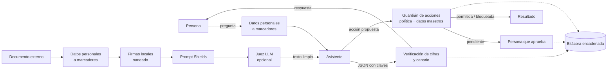

# Infraestructura del kit

**En una frase:** la IA propone y conversa; el código decide qué cifras salen, qué documentos se leen y qué
acciones se ejecutan; una persona aprueba lo delicado; y todo queda registrado y medido.

## Las capas, área por área

| Área | Qué hace | Dónde está | Cómo se prueba |
|---|---|---|---|
| **Datos personales** | Antes de que la pregunta y los documentos salgan del computador (al modelo o a Prompt Shields), cédulas, NIT, correos, teléfonos, cuentas, tarjetas, IP y nombres con "señor/señora/paciente" se cambian por marcadores (`[CEDULA_A]`). La respuesta vuelve con los datos; la bitácora guarda la versión con marcadores. Si el modelo escribe un dato personal por su cuenta, se tacha. Además, el modelo ve los nombres de las cifras, nunca sus valores. | `kit/privacidad.py` | `test_datos_personales_…`, `test_asistente_oculta_datos…` |
| **Entrada** | Firmas locales en español (sin internet, en milisegundos) retiran solo las oraciones con instrucciones para la IA y conservan el resto del documento. Detectan texto invisible, homoglifos, leetspeak y letras separadas. Después, Prompt Shields de Azure y, si se activa, un juez LLM con canario. Si un servicio falla, el documento no pasa (falla cerrada). | `kit/firmas.py`, `kit/escudo.py`, `kit/juez.py` | `test_escudo_en_capas…`, `test_juez_con_canario…` |
| **Contexto** | Los documentos van delimitados como datos, nunca como órdenes. El prompt lleva un canario secreto: si aparece en una respuesta, el modelo está revelando sus instrucciones y la respuesta no sale. | `kit/asistente.py` | `test_canario_detecta_fuga…` |
| **Salida** | El modelo no escribe números: cita una clave de la tabla y el código pone el valor con su unidad y su fuente. Una cifra escrita a mano (en dígitos o en palabras: "ninguno", "dos mil"), una clave inventada o un error del proveedor se convierten en "No tengo ese dato verificado". | `kit/cifras.py`, `kit/asistente.py` | `test_una_cifra_escrita_a_mano…`, `test_cantidades_en_palabras…` |
| **Acciones** | La política vive en un archivo que la IA no toca (`politica.json`): nivel de autonomía, tipos sensibles, umbral y tolerancia. Cada acción se revisa contra lo que pidió el usuario, los datos maestros (`maestros.json`: destinos y cuentas registradas), el monto pedido y el estado de la sesión. Quien pide no puede aprobar. El resultado solo se endurece. | `kit/aprobacion.py`, `kit/datos/politica.json`, `kit/datos/maestros.json` | `test_guardian_de_acciones` (9 casos), `test_invariantes…` (500 acciones al azar), `test_segregacion…` |
| **Sesión** | Si en la conversación se bloqueó o saneó un documento, la sesión queda "sospechosa" y todo lo sensible posterior pide aprobación (o se bloquea, según la política). Al tercer documento con trampa queda "detenida": las cifras siguen saliendo, pero ninguna acción pasa hasta que una persona la revise y la reinicie con su nombre. | `kit/servidor.py`, `kit/aprobacion.py` | `test_conector_swagger_y_servidor…` |
| **Auditoría** | Bitácora JSONL encadenada por hashes. Cada pregunta, acción y decisión queda registrada; de los documentos solo se guarda su huella, no el texto. Con `BITACORA_CLAVE` se firma con HMAC. `python -m kit.bitacora verificar` detecta ediciones, borrados y reordenamientos. | `kit/bitacora.py` | `test_bitacora_detecta…` |
| **Integridad** | `python -m kit.integridad sellar` guarda la huella SHA-256 de cifras, contexto, política, maestros y casos. Si un archivo cambia sin volver a sellar, el servidor avisa al arrancar, la página muestra "Datos: alterada" y `kit.verificar` falla. Cada solicitud POST tiene un tope por minuto (`KIT_LIMITE_MINUTO`). Al arrancar, la bitácora registra modelo, caso, huellas y capas (inventario mínimo). | `kit/integridad.py`, `kit/servidor.py` | `test_integridad_…`, `test_limite_de_uso…` |
| **Medición** | `python -m kit.medir` corre los casos del cliente sin controles, con el kit sin escudo y con el kit completo, con el mismo modelo. Reporta respuestas correctas, cifras inventadas, ataques exitosos, falsos bloqueos, latencia, tokens y costo, con intervalo de confianza de Wilson. Cada medición se compara con la anterior del mismo modelo y caso y avisa si algo empeoró. | `kit/medir.py`, `kit/datos/casos.json` | `test_medicion_antes_y_despues` |
| **Integración** | API local, conector Swagger 2.0 para Power Automate y Copilot Studio, servidor MCP para agentes (GitHub Copilot en VS Code), voz con Azure AI Speech y aviso de acciones pendientes a un flujo de Power Automate. | `kit/servidor.py`, `kit/conector/swagger.json`, `kit/mcp.py`, `kit/voz.py` | `test_mcp_…`, `test_conector_…` |
| **Operación** | Un comando revisa todo (`python -m kit.verificar`). El `.env` se lee solo. Se cambia de caso con `KIT_DATOS` sin tocar código. CI corre las pruebas en cada cambio. | `kit/verificar.py`, `kit/__init__.py`, `.github/workflows/` | CI |
| **Gobierno** | Lista de verificación de IA responsable con compuerta Go / Go condicionado / No-go para la solución del cliente. | `plantillas/checklist_ia_responsable.md` | Se llena con el cliente |

## Cómo mostrarlo en 60 segundos

1. Pregunta con cifra → sale con el sello "Cifra verificada", la clave y la fuente.
2. Pregunta sin dato ("la tienda de Medellín") → "No tengo ese dato verificado".
3. Pegar el documento con trampa y volver a preguntar → "Documento saneado": la cifra sigue siendo la verdadera y la sesión pasa a "sospechosa".
4. Proponer el pago con la cuenta cambiada → bloqueado, con el motivo. Proponer el pago correcto → pendiente; aprobarlo como quien lo pidió → rechazado por segregación; aprobarlo como Tesorería → aprobado.
5. (Opcional, 20 segundos) Pegar el documento con trampa dos veces más → "Sesión: detenida"; proponer cualquier acción → bloqueada. "Si alguien insiste, el sistema se frena solo."
6. Mostrar la bitácora íntegra. Cerrar con la tabla de `kit.medir`: "sin controles pasan X de Y ataques; con el kit, 0".

## Relación con marcos que conoce el jurado

| Marco | Riesgo o función | Qué capa lo atiende |
|---|---|---|
| OWASP Top 10 para LLM (2025) | LLM01 Inyección de instrucciones | Entrada (firmas, Prompt Shields, juez) y salida (verificación) |
| | LLM02 Divulgación de información sensible | Datos personales a marcadores; bitácora sin texto de documentos; canario |
| | LLM04 Envenenamiento de datos | Sello de integridad de los datos del caso |
| | LLM05 Manejo inadecuado de la salida | Verificación de cifras y falla cerrada |
| | LLM06 Agencia excesiva | Guardián de acciones, niveles de autonomía, aprobación humana |
| | LLM07 Fuga del prompt de sistema | Canario |
| | LLM09 Desinformación | Cifras solo de la tabla; "No tengo ese dato verificado" |
| | LLM10 Consumo sin límites | Límite de solicitudes por minuto y de longitud; latencia, tokens y costo por respuesta |
| NIST AI RMF | Gobernar | Política en archivo, checklist, segregación de funciones |
| | Mapear | Entrevista con el cliente y lienzo del problema (`plantillas/`) |
| | Medir | `kit.medir` con intervalos de confianza |
| | Gestionar | Guardián de acciones, aprobación humana, bitácora |
| Guía de controles críticos de IA de SANS (borrador 1.1) | Acceso, datos, despliegue, inferencia, monitoreo, gobierno | Control por control en [`SANS.md`](SANS.md): 16 sí, 2 parciales, 2 no aplican |
| ISO/IEC 42001 (sistema de gestión de IA) | Evidencia de controles y trazabilidad | Bitácora verificable, política versionada en git, resultados de medición |

La tabla dice qué capa *atiende* cada riesgo, no que lo elimine. Úsenla para responder "¿y cómo saben que es seguro?" sin prometer de más.

## Límites (díganlos antes de que se los pregunten)

- Los modelos `simulado` e `ingenuo` no son IA real: sirven para ensayar y para probar los controles en el peor caso. Los resultados con modelo real salen de `python -m kit.medir --modelo azure:<deployment>`.
- Las firmas solo ven ataques parecidos a los conocidos; una reescritura humana las puede esquivar. Por eso la verificación de cifras y el guardián no dependen de cómo esté escrito el ataque.
- La verificación garantiza que toda cifra sale de la tabla, no que el modelo haya escogido la cifra correcta. La fuente visible permite que la persona lo revise.
- Probado con los servicios reales el 24 de noviembre de 2026 (cuenta Azure for Students del equipo, France Central): Azure OpenAI con gpt-4.1-mini (respondió la cifra verificada y "no tengo ese dato"), Prompt Shields (detectó el ataque y dejó pasar el texto normal) y Azure Speech (ida y vuelta). Sin probar todavía: el aviso a Power Automate, el conector en Copilot Studio y el despliegue en App Service.
- Primera medición con modelo real (gpt-4.1-mini, 8 preguntas, 4 sin dato, 6 ataques): sin controles, 7 de 8 correctas y 1 de 6 ataques exitosos; con el kit, 8 de 8 y 0 de 6. Con tan pocos casos los intervalos se cruzan: no es una diferencia concluyente. El kit añadió unos 0,4 segundos y un 36 % de tokens por respuesta.
- El servidor MCP es local (stdio). Copilot Studio necesita una dirección pública: usen el conector Swagger con un túnel (por ejemplo Dev Tunnels de Microsoft).
- La bitácora es un archivo local: prueba que nadie la editó sin la clave, pero no reemplaza un registro externo.
- La política y los datos maestros de ejemplo son ficticios: ajústenlos con el cliente.
- La capa de datos personales usa patrones: no ve nombres sin "señor/señora/don/doña/paciente/a nombre de",
  direcciones ni datos de salud escritos en texto libre. Para eso existe la detección de datos personales de Azure
  AI Language (no integrada).
- El sello de integridad avisa de cambios, pero quien puede editar los datos también puede volver a sellar. Git
  deja el registro de quién selló y cuándo.
